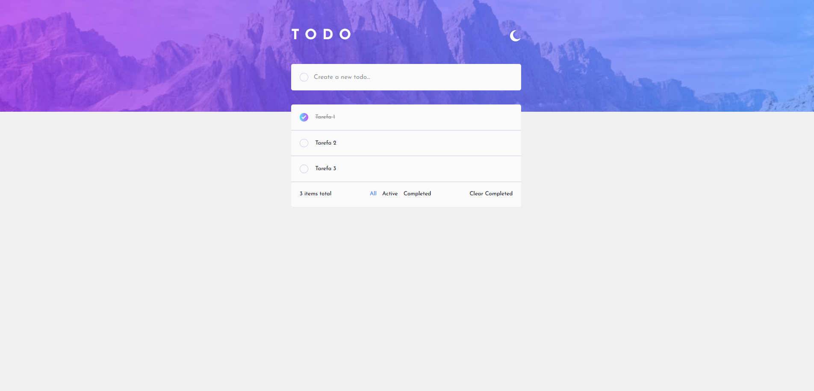
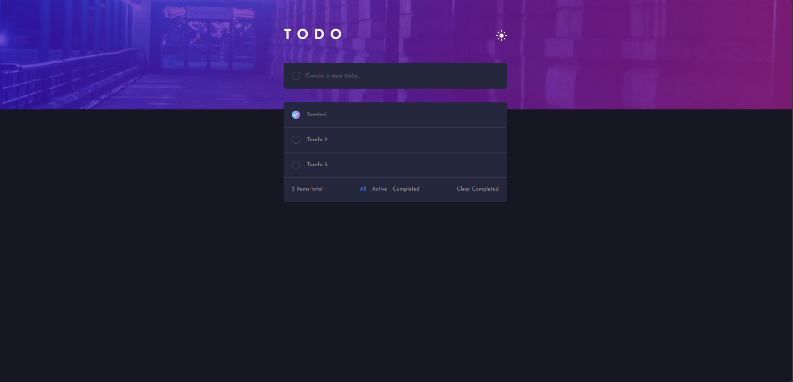

# Projeto Todo React + Tailwind do curso Dev Quest

Aplicação de lista de tarefas desenvolvida com React, TypeScript e Tailwind CSS, com suporte a tema claro/escuro e persistência das tarefas no localStorage.



## Funcionalidades

- Adicionar novas tarefas
- Marcar tarefas como concluídas
- Filtrar por:
  - Todas
  - Ativas
  - Concluídas
- Limpar tarefas concluídas
- Alternar entre tema claro e escuro
- Persistência dos dados no navegador

## Tecnologias utilizadas

- React
- TypeScript
- Vite
- Tailwind CSS
- LocalStorage

## Pré-requisitos

Antes de começar, certifique-se de ter instalado:

- Node.js 18+
- npm ou yarn

## Instalação

1. Clone o repositório:

```bash
git clone https://github.com/milennafeijo/projeto-todo-react-tailwind.git
cd seu-repositorio
```

2. Instale as dependências:

```bash
npm install
```

## Scripts disponíveis

No diretório do projeto, você pode executar:

```bash
npm run dev
```

Inicia o servidor de desenvolvimento do Vite.

```bash
npm run build
```

Gera a build de produção do projeto.

```bash
npm run preview
```

Previsualiza a build gerada localmente.

```bash
npm run lint
```

Executa a análise de lint do projeto.

## Estrutura do projeto

```text
src/
├── components/
│   ├── TodoContainer/
│   ├── TodoForm/
│   ├── TodoHeader/
│   └── TodoList/
├── contexts/
│   ├── ThemeContext.ts
│   ├── ThemeProvider.tsx
│   └── theme.ts
├── hooks/
│   └── useTodo.ts
├── styles/
│   └── globals.css
├── App.tsx
├── main.tsx
└── ...
```

## Observações

- As tarefas são salvas automaticamente no `localStorage` do navegador.
- O tema é controlado por um contexto React e muda o visual do app em tempo real.
- A aplicação segue o padrão de uma todo app moderna e responsiva.


